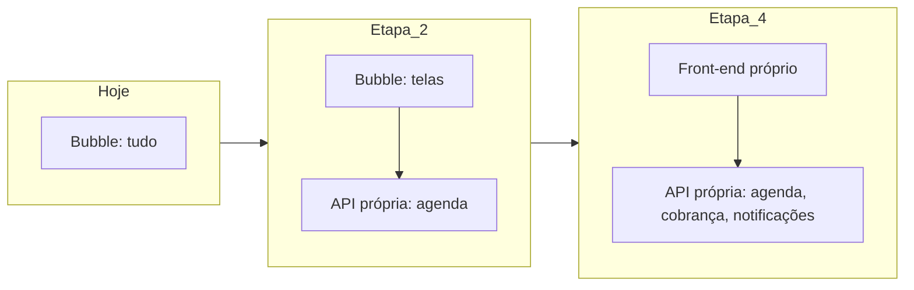

# Case demonstrativo: quando o no-code vira gargalo (Bubble → sistema próprio)

> ⚠️ **Caso demonstrativo.** A empresa, os números e os nomes abaixo são **fictícios** e servem para mostrar como a TARIQ trabalha. Não representam um cliente real.

## A empresa (fictícia)

**ClinAgenda** — startup de agendamento para clínicas. O produto foi construído em Bubble, ganhou 300 clínicas pagantes e começou a sofrer com lentidão e custo crescente da plataforma.

## O problema

- Telas lentas nos horários de pico.
- Custo da plataforma subindo junto com o uso.
- Lógica de negócio espalhada em workflows difíceis de testar.
- Dificuldade para contratar desenvolvedores que mantenham o app.

## Raio-X (o que mapeamos)

| Item | Achado |
|---|---|
| Telas | 42 páginas, 9 com consultas pesadas |
| Workflows | 180 workflows, 25 críticos (cobrança, agenda, notificações) |
| Integrações | Pagamentos, e-mail, WhatsApp |
| Dados | ~2 milhões de registros de agendamento |

## Estratégia: substituir por partes (strangler pattern)

Em vez de reescrever tudo e "virar a chave" num dia, trocamos **um módulo por vez**. O Bubble continua no ar e vai encolhendo.

| Etapa | O que muda | Risco |
|---|---|---|
| 1 | Exportar dados e documentar workflows críticos | Baixo |
| 2 | Agenda sai do Bubble para uma API própria | Médio, com volta rápida |
| 3 | Cobrança e notificações migram | Médio |
| 4 | Novo front-end; Bubble desligado | Planejado e testado |

## Resultado esperado (ilustrativo)

- Telas críticas mais rápidas.
- Custo previsível de infraestrutura.
- Código testável e equipe mais fácil de contratar.

## Lição

O no-code **não foi um erro**: ele levou a empresa até aqui. O ponto é reconhecer quando ele deixou de ser acelerador e virou freio.

---

Seu no-code virou gargalo? **[tariqtech.com.br](https://tariqtech.com.br)** · contato@tariqtech.com.br

Conteúdo preparado com apoio da Tari, assistente de IA da TARIQ.
